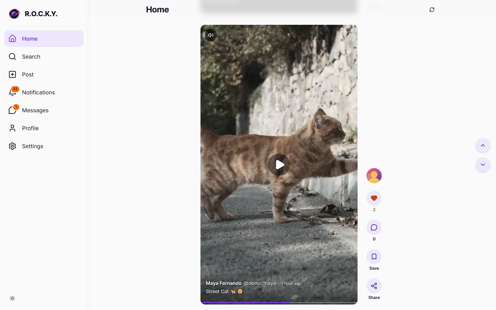
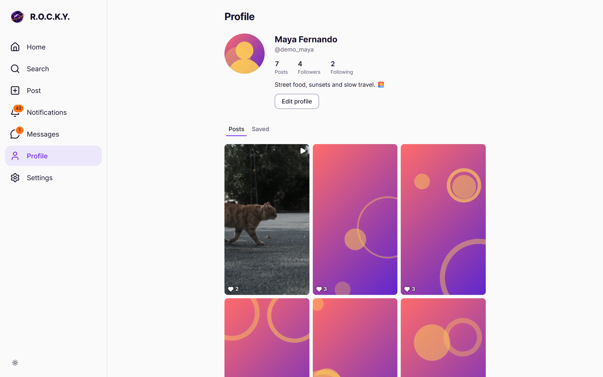
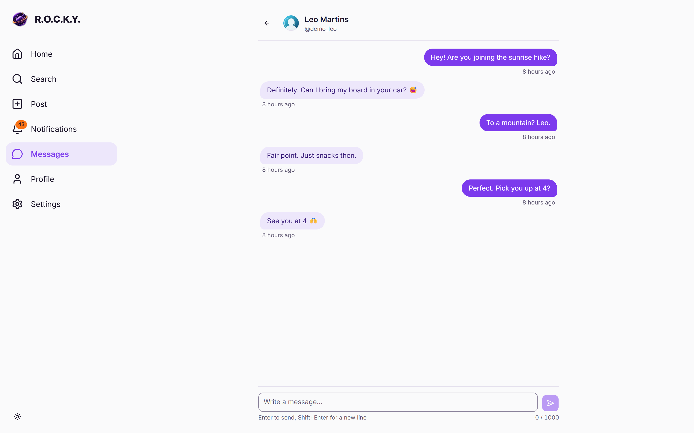
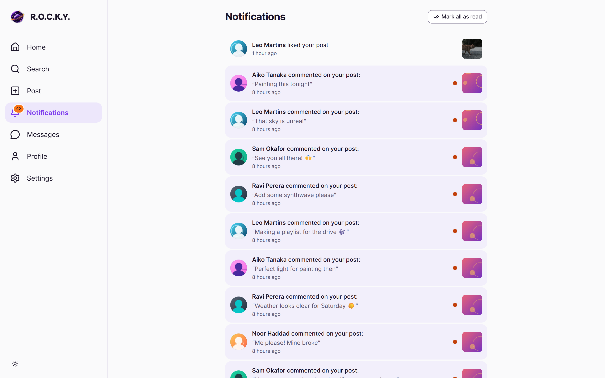
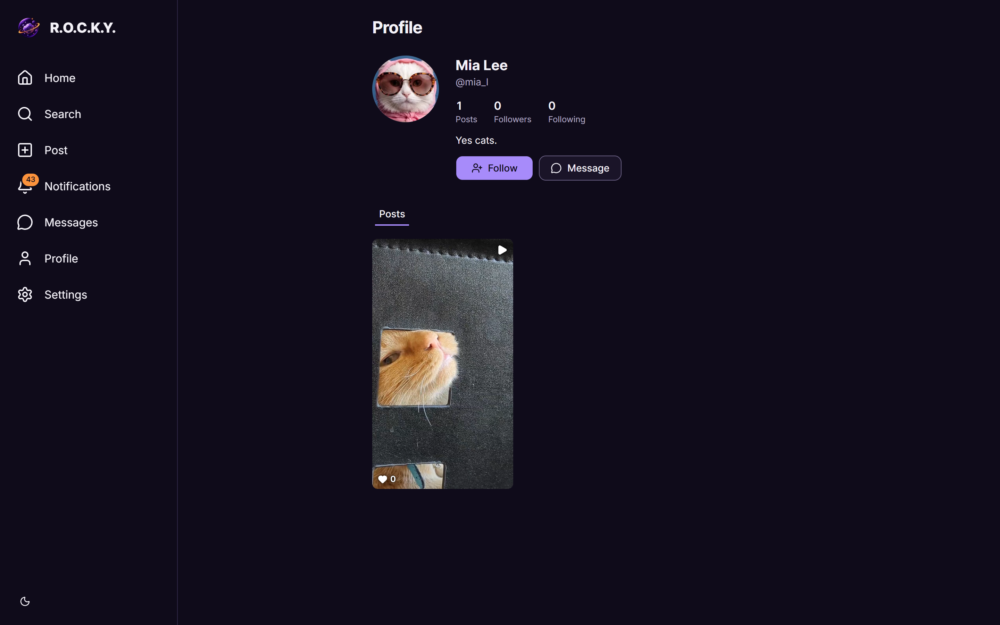
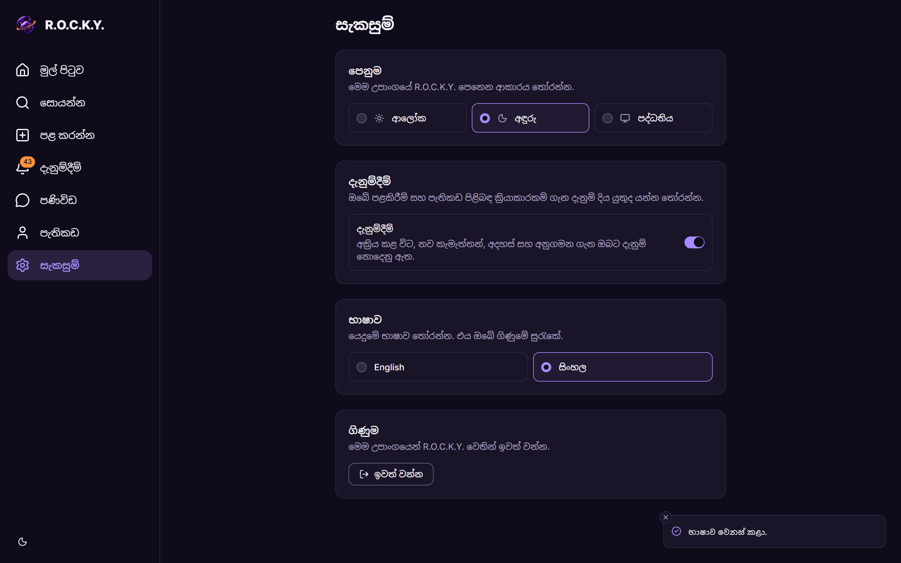
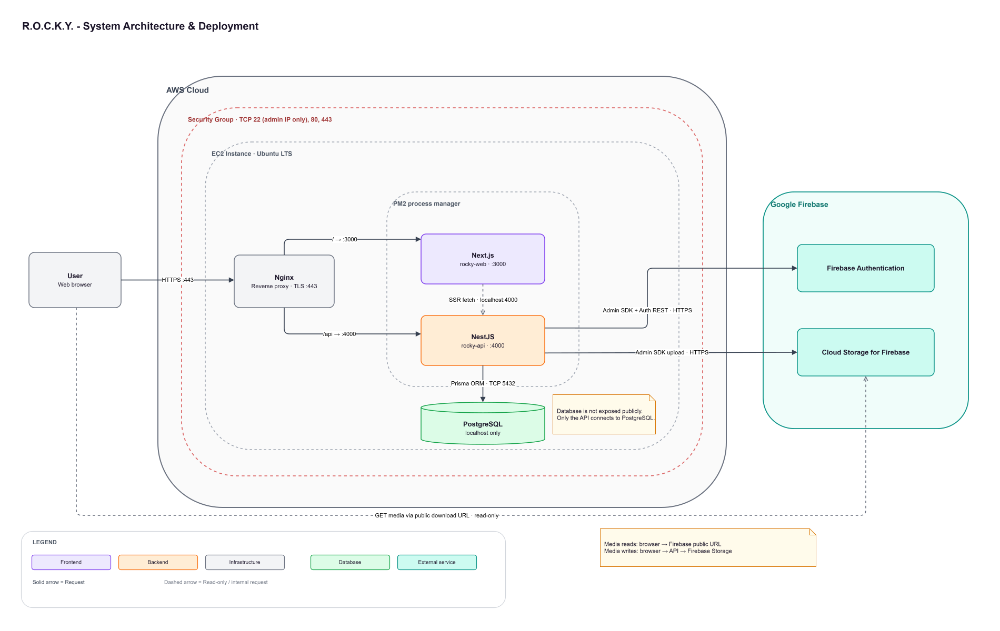
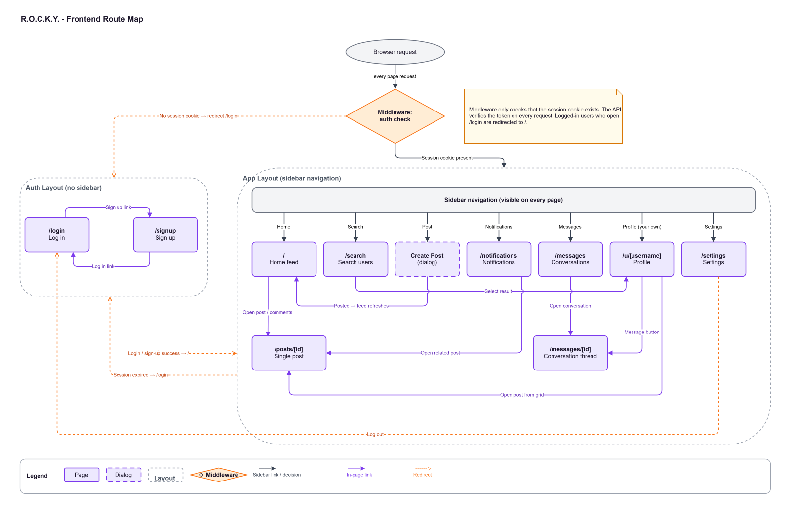

<p align="center">
  
</p>

<h1 align="center">R.O.C.K.Y. (Regular Online Content Kernel Yarn)</h1>

<p align="center"><em>Named after Rocky from Project Hail Mary.</em></p>

<p align="center">
  <a href="https://github.com/ChathuniPG/rocky-web/actions/workflows/ci.yml"></a>
</p>

<p align="center">
  <a href="https://rocky-social.duckdns.org">Live site</a> ·
  <a href="https://rocky-social.duckdns.org/api/docs">Live API docs (Swagger)</a> ·
  <a href="https://github.com/ChathuniPG/rocky-api">Backend repository (rocky-api)</a>
</p>

---

## Contents

- [Project Overview](#project-overview)
- [Screenshots](#screenshots)
- [Architecture](#architecture)
- [Features Implemented](#features-implemented)
- [Technology Stack](#technology-stack)
- [Installation](#installation)
- [Run Instructions](#run-instructions)
- [Environment Variables](#environment-variables)
- [Design Decisions](#design-decisions)
- [Accessibility](#accessibility)
- [Testing](#testing)
- [AWS EC2 Deployment Steps](#aws-ec2-deployment-steps)
- [Known Limitations](#known-limitations)
- [Future Improvements](#future-improvements)
- [AI-assisted development](#ai-assisted-development)
- [Documentation](#documentation)

## Project Overview

R.O.C.K.Y. is a TikTok-style social media platform built as a full-stack technical assessment.
Users sign up, post photos and short videos, scroll a full-screen feed, like, save and comment on
posts, follow each other, get notifications and send direct messages.

This repository, **rocky-web**, is the frontend: a Next.js (App Router) application in TypeScript
with Tailwind CSS and shadcn/ui. The browser talks only to the API at the same-origin path
`/api/v1`. It never calls Firebase or PostgreSQL. The backend,
[rocky-api](https://github.com/ChathuniPG/rocky-api), is a NestJS REST API in a separate
repository. Both run on one AWS EC2 instance behind Nginx at
**https://rocky-social.duckdns.org**.

### Demo login

| Email                              | Password    |
| ---------------------------------- | ----------- |
| `demo.maya+production@example.com` | `Rocky1234` |

The production database is seeded with six demo users who share this password: `demo_maya`,
`demo_leo`, `demo_aiko`, `demo_sam`, `demo_noor` and `demo_ravi`. Their emails follow the same
pattern, `demo.<name>+production@example.com` (for example `demo.leo+production@example.com`).

## Screenshots



_Home: one post per screen, with the action column beside the media and Previous/Next controls at
the right edge_



_Profile: counts, follow and message actions, and the Posts and Saved grids_



_Messages: a one-to-one conversation, updated by polling_



_Notifications: unread items highlighted, with mark one or all as read_



_Dark mode: the same purple and orange palette in the dark theme_



_Sinhala: the whole interface translated, set in Noto Sans Sinhala_

## Architecture

R.O.C.K.Y. is a three-tier system on a single EC2 instance. Nginx is the only public entry point
and routes by path: `/api/` goes to rocky-api on `127.0.0.1:4000` and everything else goes to this
app on `127.0.0.1:3000` (ADR-004). In development, `next.config.ts` rewrites `/api/*` to the local
API, so the browser sees one origin in both environments. The API keeps the Firebase tokens in
httpOnly cookies, so this app never reads, stores or sends a token itself (ADR-003).



_Figure 1: System architecture: deployment of R.O.C.K.Y. on a single AWS EC2 instance_

| Route                         | Page                               |
| ----------------------------- | ---------------------------------- |
| `/login`, `/signup`           | Authentication (no navigation bar) |
| `/`                           | Home feed                          |
| `/search`                     | Search users                       |
| `/u/[username]`               | Profile (Posts and Saved tabs)     |
| `/posts/[id]`                 | Single post                        |
| `/notifications`              | Notifications                      |
| `/messages`, `/messages/[id]` | Conversation list and thread       |
| `/settings`                   | Settings                           |

The "Post" navigation item opens a create-post dialog instead of a separate page.



_Figure 5: Frontend route map: routes and layouts of rocky-web_

Source layout:

```text
src/
├── app/           routes: (auth) for /login and /signup, (app) for the signed-in pages
├── components/    shared components; ui/ holds the shadcn/ui components
├── features/      feature code: auth, comments, feed, media, messages, navigation,
│                  notifications, posts, profile, search, settings, users
├── hooks/         shared hooks (scroll snapping, in-view, reduced motion, focus hand-off)
├── i18n/          I18nProvider, translation helpers and the en/si dictionaries
└── lib/           API client and generated types (api/), env validation, formatting, utilities
```

More detail: [design.md §7 Frontend Design](docs/design.md#7-frontend-design-rocky-web).

## Features Implemented

**Feed**

- A TikTok-style feed: one post per screen with mandatory snap scrolling. The media sits in a 9:16
  frame and is never cropped. Like, comment, save and share sit in a column beside it
  (FR-FEED-01–08, FR-FEED-10).
- Previous and Next buttons replace the scrollbar on wide screens, and the Up and Down arrow keys
  move one post at a time. Movement is instant when the user prefers reduced motion.
- Infinite scroll, with a "Load more" fallback. The next page is fetched a few posts before the
  end, so its first videos can buffer in time.
- A custom video player (FR-FEED-09). The most visible video autoplays and loops, and only one
  plays at a time. Videos pause when scrolled away or when the tab is hidden, and never autoplay
  under reduced motion. Click to play or pause. The sound control sits in the top-left corner and
  the sound preference lasts for the session. A thin seekable progress bar runs along the bottom.
  Every control works from the keyboard.
- Only the videos near the current post get a real player (windowing). The next one is preloaded
  (look-ahead).

**Posts and comments**

- Optimistic likes, saves and follows: counts change at once and roll back with an error toast if
  the request fails (FR-FEED-03, FR-FEED-04, FR-PROF-05).
- Share copies the post link, with a confirmation toast (FR-FEED-05).
- A post page (`/posts/[id]`) with the media on the left and comments on the right on wide screens.
  Add and delete your own comments. The Back button and Escape return to the previous page with its
  scroll position, or go Home for a shared link (FR-FEED-06, FR-POST-06, FR-POST-07).
- Create a post with drag and drop or a file picker. Type and size are checked first (JPEG, PNG and
  WebP up to 5 MB, MP4 and WebM up to 25 MB). The upload shows its progress and can be cancelled
  (FR-POST-01–03).
- Owners can edit the caption or delete the post after a confirmation dialog (FR-POST-04,
  FR-POST-05).

**Search and profiles**

- Debounced user search with All and Following filters. The query and the filter live in the URL,
  so a search can be shared and survives Back (FR-SRCH-01–04).
- Profiles show the avatar, bio, counts and Posts and Saved grids. Saved is visible only to the
  owner. Follow, message, and edit your own profile: display name, bio and avatar (FR-PROF-01–06).

**Notifications and messages**

- Notifications, with unread items marked and mark one or all as read (FR-NOTF-01–03).
- Conversations and threads. New messages arrive by polling: every 4 s in an open thread, and every
  15 s for the conversation list (FR-MSG-01–05, ADR-008).
- Navigation badges for unread notifications and unread conversations, polled every 30 s and
  updated at once after reading (FR-NOTF-04, FR-MSG-06). No polling runs while the tab is hidden.

**Settings**

- Light, Dark and System themes, through next-themes (FR-SET-01).
- A notifications on/off setting stored on the server (FR-SET-02).
- English and Sinhala. The language is saved to the account and remembered on the device, so
  signed-out pages use it too. The most recent deliberate choice wins (FR-SET-03, design.md §7.3).
- Log out with a confirmation dialog (FR-SET-04).

**Authentication**

- Sign-up and login forms built with react-hook-form and zod, with clear error messages and no
  duplicate submits (FR-AUTH-01–05).
- Client-side route protection. An AuthProvider loads `/auth/me`. On a 401 the API client refreshes
  the session once, shares that one refresh between concurrent requests, and retries the original
  request. Only if the refresh fails is the user sent to `/login?next=<path>`, so sessions outlive
  the one-hour ID token (FR-AUTH-07, FR-AUTH-08, ADR-013).
- Logout, session expiry, login and signup end with a full page load, so nothing from one account
  carries over to the next (FR-AUTH-06, ADR-014).

**UI quality**

- Skeletons for loading content, spinners for actions, a meaningful empty state for every list, and
  toast feedback for every action (FR-UI-02–05).
- A purple primary colour and an orange accent in both themes (FR-UI-06).
- Responsive layout: an icon-only sidebar on small laptops, a capped content column, and a
  suggested-users panel on widescreens (NFR-UX-01).
- Accessibility: see [Accessibility](#accessibility).

## Technology Stack

| Area            | Technology                                                                           |
| --------------- | ------------------------------------------------------------------------------------ |
| Runtime         | Node.js 26 (`.nvmrc`, `package.json` `engines`)                                      |
| Framework       | Next.js 16.4.5 (App Router, `cacheComponents`), React 19.3.0                         |
| Language        | TypeScript 5.9 (strict)                                                              |
| Styling         | Tailwind CSS 4, `tw-animate-css`, `prettier-plugin-tailwindcss`                      |
| Components      | shadcn/ui (`shadcn` 4.23 CLI) on `radix-ui` 1.8, lucide-react 1.70 icons             |
| Server data     | TanStack Query 5.107 (`@tanstack/react-query`)                                       |
| Forms           | react-hook-form 7.91, zod 4.6, `@hookform/resolvers`                                 |
| Theme and toast | next-themes 0.4.6, sonner 2.0                                                        |
| API types       | openapi-typescript 7.13, generated from `docs/openapi.json`                          |
| Tests           | Vitest 5.1                                                                           |
| Code quality    | ESLint 9 with `eslint-config-next` 16.4.5 and `eslint-config-prettier`, Prettier 3.9 |
| Deployment      | AWS EC2 (Ubuntu), Nginx, PM2, GitHub Actions for CI                                  |

## Installation

**Prerequisites**

- Node.js 26 and npm (`.nvmrc`, `package.json` `engines`)
- [rocky-api](https://github.com/ChathuniPG/rocky-api) running locally on `127.0.0.1:4000` (see
  its README). Without it, only the signed-out pages render, and they cannot sign in.

**Steps**

```bash
git clone https://github.com/ChathuniPG/rocky-web.git
cd rocky-web

# Use the Node.js version in .nvmrc (26).
nvm use

# Install exactly what package-lock.json lists.
npm ci

# Create your local configuration and set FIREBASE_STORAGE_BUCKET (see Environment Variables).
cp .env.example .env.local
```

## Run Instructions

Start the development server:

```bash
npm run dev
```

Open http://localhost:3000. The dev server rewrites `/api/*` to `API_INTERNAL_URL`
(`http://127.0.0.1:4000` by default), the same way Nginx routes `/api` in production (ADR-004).
Under `next dev` only, `/dev/components` shows a showcase of the shared components. Production
builds leave it out.

Other scripts:

| Script                                    | Purpose                                                                  |
| ----------------------------------------- | ------------------------------------------------------------------------ |
| `npm run build` / `npm start`             | Production build, then `next start` on `127.0.0.1:3000`                  |
| `npm run lint` / `npm run lint:fix`       | ESLint                                                                   |
| `npm run format` / `npm run format:check` | Prettier                                                                 |
| `npm run typecheck`                       | `next typegen && tsc --noEmit`                                           |
| `npm test`                                | Unit tests (`vitest run`)                                                |
| `npm run generate:api`                    | Regenerate `src/lib/api/schema.d.ts` from `docs/openapi.json`            |
| `npm run ui:add -- <component...>`        | Add shadcn/ui components through the wrapper in `scripts/shadcn-add.mjs` |

## Environment Variables

Both variables are described in [`.env.example`](.env.example). Copy it to `.env.local` and set
your values. `.env.local` is never committed.

| Variable                  | Required | Purpose                                                                                                         |
| ------------------------- | -------- | --------------------------------------------------------------------------------------------------------------- |
| `API_INTERNAL_URL`        | No       | Base URL of rocky-api for the `/api` rewrite, default `http://127.0.0.1:4000`. Use `127.0.0.1`, not `localhost` |
| `FIREBASE_STORAGE_BUCKET` | Yes      | Bucket name, without `gs://`. `next/image` only optimises media from this bucket                                |

- **Server-only.** Neither variable has the `NEXT_PUBLIC_` prefix, so neither reaches the browser
  bundle.
- **Validated at build time and at runtime.** `next.config.ts` checks them with `parseServerEnv`
  (`src/lib/server-env-schema.ts`) when `next build` runs and again when `next start` runs. A
  missing or invalid value stops the build or the server. The values are baked into the build, so
  a change needs a rebuild (`deploy/redeploy.sh` always rebuilds).
- **No Firebase or database credentials.** The frontend never talks to Firebase or PostgreSQL, and
  it never handles tokens (ADR-003, ADR-004). The Firebase service account, the Web API key and
  `DATABASE_URL` are configured only in rocky-api; see its
  [Environment Variables](https://github.com/ChathuniPG/rocky-api#environment-variables).
  `FIREBASE_STORAGE_BUCKET` is only a bucket name, not a secret.

## Design Decisions

The Architecture Decision Records are in [design.md §8](docs/design.md#8-architecture-decision-records).
These are the ones that shape the frontend:

| ADR                                                                              | Decision                                                                                                 |
| -------------------------------------------------------------------------------- | -------------------------------------------------------------------------------------------------------- |
| [ADR-003](docs/design.md#adr-003-httponly-cookies-for-token-storage)             | Tokens in httpOnly cookies set by the API. The frontend never reads or stores a token                    |
| [ADR-004](docs/design.md#adr-004-single-domain-with-nginx-path-based-routing)    | One domain: the browser only calls same-origin `/api/v1`. Nginx in production, a Next.js rewrite locally |
| [ADR-008](docs/design.md#adr-008-polling-for-new-messages)                       | Messages and badges are polled with TanStack Query's `refetchInterval` instead of WebSockets             |
| [ADR-013](docs/design.md#adr-013-client-side-route-protection)                   | Route protection on the client, with one silent refresh, so sessions survive ID-token expiry             |
| [ADR-014](docs/design.md#adr-014-full-page-load-when-the-signed-in-user-changes) | Full page load when the signed-in user changes, so no state carries over between accounts                |

Further decisions in the implementation:

- **A typed API client generated from the contract.** Every call goes through one client
  (`src/lib/api/client.ts`). Its request and response types come from `src/lib/api/schema.d.ts`,
  which `npm run generate:api` generates from `docs/openapi.json`, the contract exported from
  rocky-api. No API type is written by hand. CI fails if the generated file is out of date.
- **TanStack Query for all server data, with optimistic updates.** Server data is never copied into
  local state. Likes, saves, follows, settings, sent messages and read markers update the cache at
  once. Like and save roll back per post, so a failure on one post does not undo another post's
  change. The state transitions are idempotent, so rolling back a change that a later click already
  reversed never drifts the counts (`src/features/posts/post-state.ts`).
- **Cached pages stay mounted, and protected pages export `instant = false`.** With
  `cacheComponents`, Next.js keeps visited pages mounted but hidden (React Activity), so going
  back to Home keeps the feed and its position. Videos on hidden pages are paused. Signed-in pages
  only render after the AuthGate confirms the session in the browser (ADR-013), so Next.js cannot
  prerender them to check instant navigation. Each of the 8 pages under `src/app/(app)` therefore
  exports `instant = false`.
- **Feed video windowing and look-ahead.** Only the current post and the next two get a
  `<video>` element. Passed videos are unmounted, which clears their source so they stop
  downloading and stop competing with the next one. The next video is buffered ahead unless the
  browser reports data saver or a slow connection, and the next feed page is fetched early. With a
  throttled connection across a page boundary, playback stalls fell from nine to one
  (FR-FEED-09, NFR-PERF-03).
- **Translations as typed dictionaries.** All user-facing text lives in
  `src/i18n/dictionaries/en.json` and `si.json`. Keys are typed, so a missing or misspelt key fails
  the type check. Templates such as `{name} liked your post` are split into parts
  (`src/i18n/template-parts.ts`), so each language places the bold name wherever its word order
  needs it. Sinhala is set in Noto Sans Sinhala, and layouts allow its longer text.

## Accessibility

The accessibility and responsive audit (issue #15) is documented in
[docs/accessibility-audit.md](docs/accessibility-audit.md). It covered every page, dialog and menu
at widths from 1024 to 2560 px, at 200 % zoom and at 400 % reflow, in light and dark and in English
and Sinhala. After the fixes:

- **axe-core:** 0 violations on every page, in all four combinations of theme and language
  (WCAG 2.2 A and AA rules plus best practice).
- **Lighthouse accessibility:** 100 on every page in both themes. The 404 page is the exception
  only because Lighthouse does not score pages that return HTTP 404; axe finds nothing on it.
- **Keyboard:** a skip link, a visible focus ring on every Tab stop, focus trapped in dialogs and
  returned to their opener, and keyboard control of the feed and the video player.
- **Images:** responsive `sizes` and `next/image` avatars cut downloads to about 1.1 times the
  displayed size (from up to 3.3 times for post media and up to 10.8 times for avatars). CLS is 0
  on every page.
- Reduced motion turns off dialog and skeleton animations. Tab titles follow the active language.

## Testing

| Suite | Command    | Count                 | Needs                                     |
| ----- | ---------- | --------------------- | ----------------------------------------- |
| Unit  | `npm test` | 385 tests in 39 files | Nothing: no API, browser or network calls |

- **Unit tests** (`*.test.ts`) sit next to the code they test. They cover the logic: form schemas,
  error mapping, cache updates and rollbacks, feed stepping and visibility, video coordination and
  preloading, safe redirects, scroll restoration, the upload client and translation helpers.
- **CI** (GitHub Actions) runs on every pull request and every push to `main`. It runs lint, the
  format check, a check that the generated API types match `docs/openapi.json`, typecheck, unit
  tests and the production build. It needs no secrets. See [docs/ci.md](docs/ci.md).
- **No end-to-end tests.** They would need a running rocky-api with its live Firebase project.
  Behaviour in the browser was verified manually under `next dev` against a local rocky-api, and
  by the [accessibility audit](docs/accessibility-audit.md).

## AWS EC2 Deployment Steps

rocky-web runs on the same EC2 instance as rocky-api. The full, tested guide is in rocky-api's
[docs/deployment.md](https://github.com/ChathuniPG/rocky-api/blob/main/docs/deployment.md).
[§16 Frontend and HTTPS](https://github.com/ChathuniPG/rocky-api/blob/main/docs/deployment.md#16-frontend-and-https)
covers this app. In brief:

1. **Instance, Node.js, Nginx and PM2** are shared with the API: Ubuntu on a `t3.small` with an
   Elastic IP. The security group opens only 22 (from the admin IP), 80 and 443, and port 3000 is
   never opened (rocky-api deployment.md §2–§8).
2. **Clone:** `git clone https://github.com/ChathuniPG/rocky-web.git` into `~/rocky/rocky-web`.
3. **Environment:** create `.env.local` in the repository root **before** the build, with
   `FIREBASE_STORAGE_BUCKET` (the API's bucket name) and `API_INTERNAL_URL=http://127.0.0.1:4000`.
   Then `chmod 600 .env.local`.
4. **Build and start:** `npm ci --include=dev`, `npm run build`, `pm2 start ecosystem.config.cjs`
   and `pm2 save`. [`ecosystem.config.cjs`](ecosystem.config.cjs) runs `next start` as one fork
   instance named `rocky-web`, bound to `127.0.0.1:3000` so only Nginx can reach it. It restarts
   on crash and allows 15 s for a graceful shutdown. `pm2 startup` restores it after a reboot
   (NFR-OPS-01).
5. **Nginx and HTTPS:** rocky-api's `deploy/nginx/rocky.conf` proxies `/api/` to `127.0.0.1:4000`
   and `/` to `127.0.0.1:3000`, with buffering off so streamed pages arrive in chunks. certbot adds
   a Let's Encrypt certificate for `rocky-social.duckdns.org`, redirects HTTP to HTTPS, and the
   config sends HSTS.
6. **Redeploy:** `bash deploy/redeploy.sh` pulls (`--ff-only`), runs `npm ci --include=dev`,
   builds, reloads or starts the PM2 app, runs `pm2 save`, and polls
   `http://127.0.0.1:3000/login` until it returns 200 (15 attempts, 2 s apart).

## Known Limitations

- **Language before hydration (A11Y-16).** The language is stored on the device in localStorage,
  which the server cannot read. With a stored Sinhala preference, signed-out pages briefly show
  English, and `<html lang>` switches to `si` only after hydration. Signed-in pages show a skeleton
  until then.
- **Polling, not real-time.** New messages, notifications and badge counts arrive on the next poll
  (ADR-008).
- **The conversation list refetches every loaded page** on each poll, not only the first.
- **No phone layouts.** The design targets 1024 px and wider. Below 768 px nothing overflows (it
  reflows at 400 % zoom), but the layout is not designed for phones.

## Future Improvements

- Real-time messages and notifications with WebSockets or Server-Sent Events.
- Followers and following lists, and follow status on feed posts.
- Phone layouts.
- A two-pane messages layout (list and thread side by side) on wide screens.
- Polling only the first page of the conversation list.
- AAA criteria such as enhanced contrast (WCAG 1.4.6).

## AI-assisted development

This project was built with [Claude Code](https://claude.com/claude-code) as an AI pair
programmer, guided by the rules in [`CLAUDE.md`](CLAUDE.md): architecture, code standards,
testing and security. The developer planned, reviewed, tested and committed every change, through
GitHub issues and pull requests that pass CI.

## Documentation

| Document                                                   | Contents                                                          |
| ---------------------------------------------------------- | ----------------------------------------------------------------- |
| [docs/requirements.md](docs/requirements.md)               | Functional and non-functional requirements (`FR-*`, `NFR-*`)      |
| [docs/design.md](docs/design.md)                           | Architecture, authentication, API contract, frontend design, ADRs |
| [docs/accessibility-audit.md](docs/accessibility-audit.md) | Accessibility and responsive audit: findings, fixes and scores    |
| [docs/ci.md](docs/ci.md)                                   | GitHub Actions workflow and what it checks                        |
| [docs/openapi.json](docs/openapi.json)                     | The API contract exported from rocky-api                          |
| [docs/diagrams/](docs/diagrams/)                           | Editable draw.io SVG diagrams (Figures 1–5)                       |
