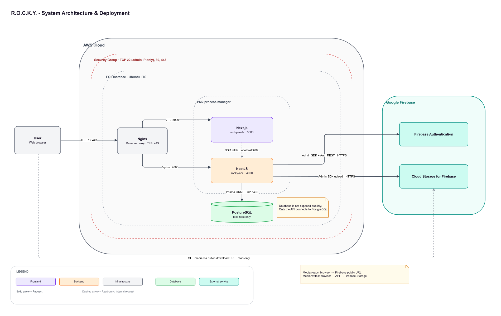
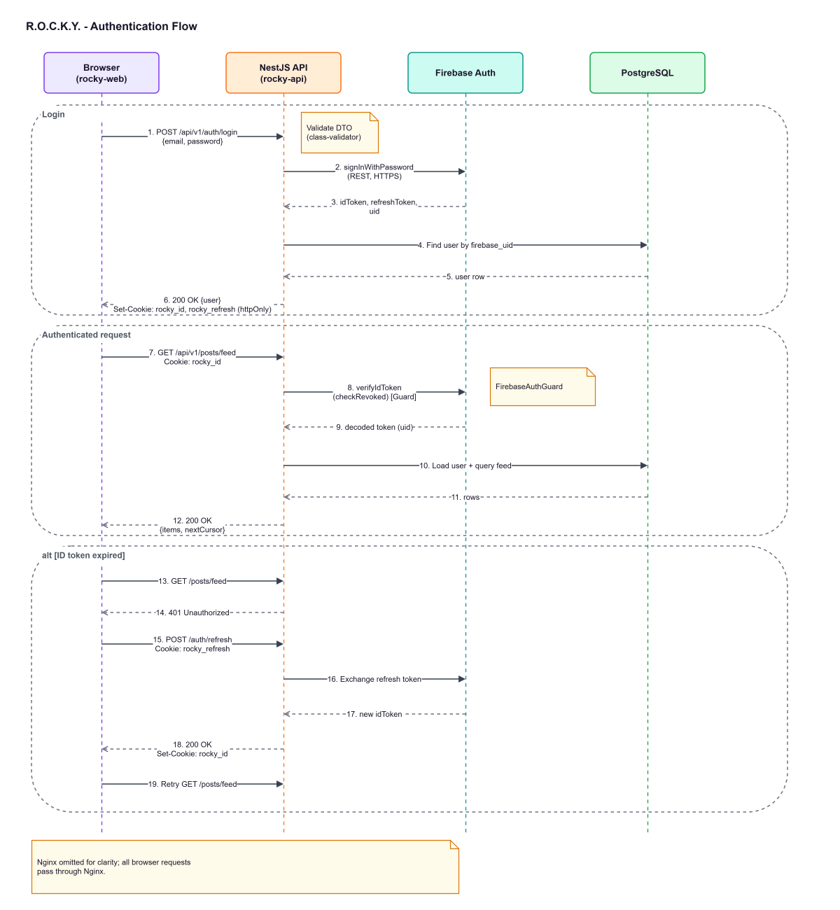
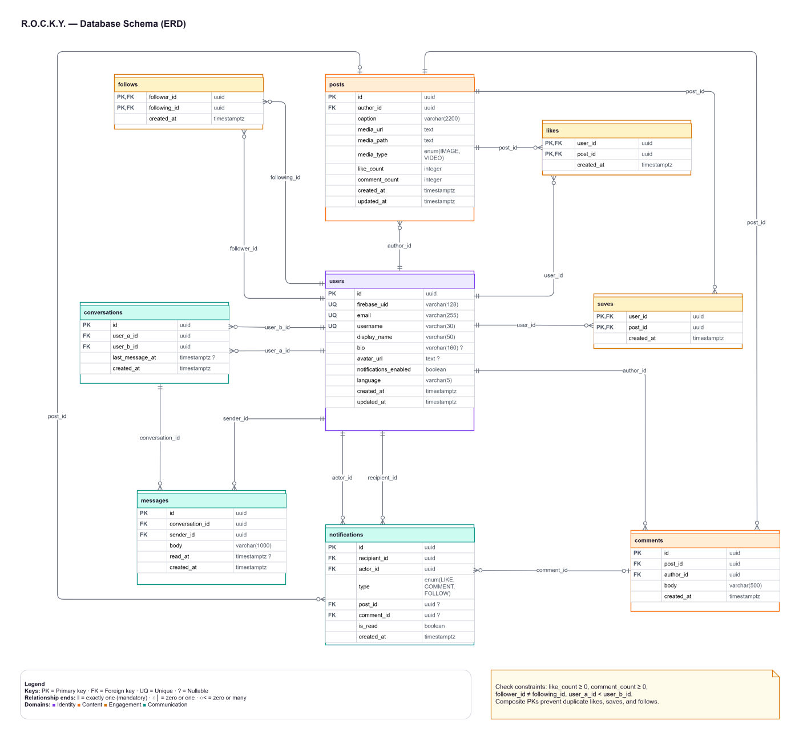
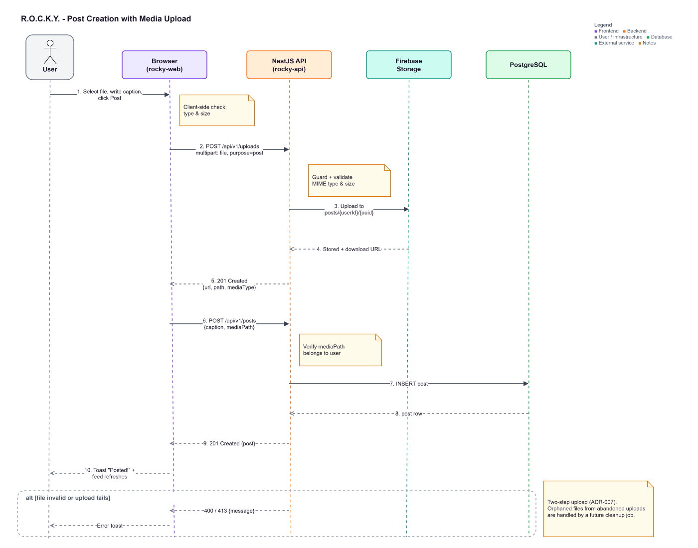
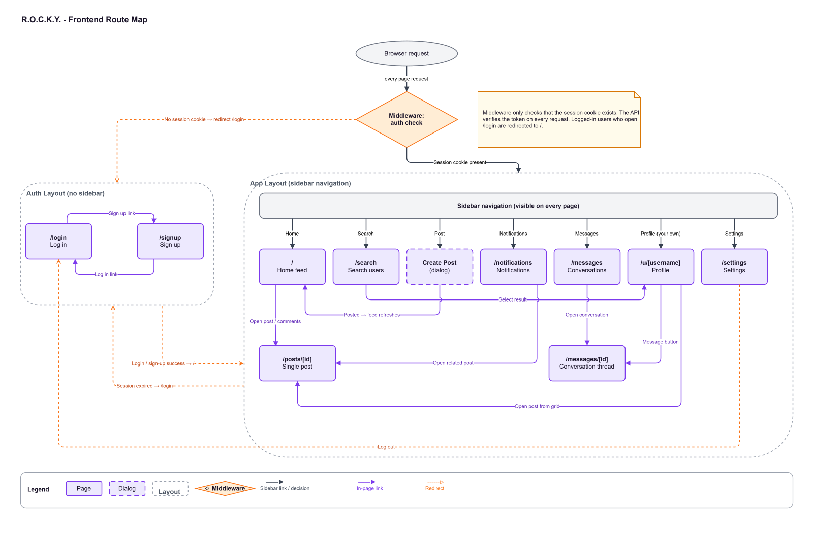

# R.O.C.K.Y. - Software Design Document

| **Version** | **Date**    | **Author**        | **Status** |
|-------------|-------------|-------------------|------------|
| 0.1         | 04 Nov 2026 | Chathuni Gunasena | Draft      |
| 0.2         | 05 Nov 2026 | Chathuni Gunasena | Align index definitions with query ordering.      |
| 0.3         | 06 Nov 2026 | Chathuni Gunasena | Added ADR-011 (Service account loaded from file path), Added ADR-012 (In-memory rate-limit storage).      |
| 0.4         | 06 Nov 2026 | Chathuni Gunasena | Millisecond created_at precision on cursor-paginated tables; posts.media_path unique.      |
| 0.5         | 07 Nov 2026 | Chathuni Gunasena | Added ADR-013 (Client-side route protection via AuthProvider to support seamless token refreshes).      |
| 0.6         | 07 Nov 2026 | Chathuni Gunasena | Section 7.2: TikTok-style feed and post layout (FR-FEED-10, FR-POST-07).      |
| 0.7         | 07 Nov 2026 | Chathuni Gunasena | Section 7.2: custom video player with autoplay (FR-FEED-09).      |
| 0.8         | 08 Nov 2026 | Chathuni Gunasena | Section 7.2: text halo instead of a dark band for text over media; scrolling expanded captions.      |
| 0.9         | 08 Nov 2026 | Chathuni Gunasena | Added ADR-014 (Full page load when the signed-in user changes); Section 7.3 references it.      |
| 0.10        | 08 Nov 2026 | Chathuni Gunasena | Section 7.3: language rule, the most recent deliberate choice wins (FR-SET-03).      |
| 0.11        | 08 Nov 2026 | Chathuni Gunasena | Section 5.2: added GET /conversations/unread-count (FR-MSG-06).      |
| 0.12        | 08 Nov 2026 | Chathuni Gunasena | Section 7.2: previous/next feed controls replace the scrollbar (FR-FEED-10).      |
| 0.13        | 09 Nov 2026 | Chathuni Gunasena | Figures 1–5 embedded as editable draw.io SVG exports; Section 7.4: removed the broken colour-palette image link (the token table is the reference); Section 5.2: logout is public, matching the code.      |

## 1. Purpose

This document describes the architecture, data model, API contract, and key technical decisions for R.O.C.K.Y. (Regular Online Content Kernel Yarn). It implements the requirements defined in the R.O.C.K.Y. Software Requirements Specification v0.1.

## 2. System Architecture

### 2.1 Overview

R.O.C.K.Y. uses a three-tier architecture deployed on a single AWS EC2 instance:

1.  **Presentation tier:** Next.js web application (rocky-web).

2.  **Application tier:** NestJS REST API (rocky-api).

3.  **Data tier:** PostgreSQL (application data), Firebase Authentication (identity), and Firebase Storage (media).

Nginx is the single public entry point. It routes requests by path, so the browser sees one domain for both the website and the API.

### 2.2 Deployment Diagram

Figure 1 shows the deployed system, including how Nginx routes traffic and which components communicate with PostgreSQL and Firebase.

*Figure 1: System architecture: deployment of R.O.C.K.Y. on a single AWS EC2 instance*

### 2.3 Communication Rules

- The browser talks only to Nginx on one domain.

- Next.js calls the NestJS API at /api/v1/....

- Only NestJS communicates with PostgreSQL and Firebase.

- PostgreSQL listens on localhost only and is never exposed to the internet.

## 3. Authentication Design

### 3.1 Overview

The Firebase Admin SDK can create users and verify tokens, but it cannot verify a password. NestJS therefore uses two Firebase interfaces:

- The **Firebase Auth REST API** for sign-in and token refresh.

- The **Firebase Admin SDK** for user creation, token verification, and token revocation.

### 3.2 Token Storage

After sign-up or login, NestJS sets two cookies on the response. Both are httpOnly, Secure, and SameSite=Lax, so JavaScript cannot read them.

- rocky_id: the Firebase ID token (expires in 1 hour).

- rocky_refresh: the Firebase refresh token, scoped to the path /api/v1/auth.

### 3.3 Sign-Up Flow

1.  The client sends POST /api/v1/auth/signup with email, password, username, and display name.

2.  NestJS validates the DTO and checks that the username is available in PostgreSQL.

3.  NestJS creates the Firebase user with the Admin SDK (createUser).

4.  NestJS inserts a row into users with the returned firebase_uid.

5.  If step 4 fails, NestJS deletes the Firebase user (a compensating action) so the two systems stay consistent.

6.  NestJS signs the user in via the REST API, sets the cookies, and returns the user profile.

### 3.4 Login Flow

1.  The client sends POST /api/v1/auth/login.

2.  NestJS calls the Firebase REST signInWithPassword endpoint.

3.  Firebase errors are mapped to safe, user-friendly messages. For example, both “wrong password” and “user not found” become “Invalid email or password,” which avoids revealing which emails are registered.

4.  NestJS sets the cookies and returns the user profile.

### 3.5 Authenticated Request Flow

1.  The browser automatically sends the rocky_id cookie with the request.

2.  FirebaseAuthGuard verifies the token with verifyIdToken(token, checkRevoked: true).

3.  The guard loads the matching user from PostgreSQL and attaches it to the request.

4.  Controllers access the user through a custom @CurrentUser() decorator.

### 3.6 Token Refresh and Logout

- **Refresh:** when the API returns 401, the frontend calls POST /api/v1/auth/refresh once. NestJS exchanges the refresh token with Firebase’s secure token endpoint, sets new cookies, and the frontend retries the original request.

- **Logout:** POST /api/v1/auth/logout revokes the user’s refresh tokens via the Admin SDK and clears both cookies.

### 3.7 Authentication Sequence

Figure 2 illustrates the complete authentication lifecycle described in Sections 3.2 to 3.6.

*Figure 2: Authentication flow: login, an authenticated API request, and automatic ID token refresh*

## 4. Data Model

### 4.1 Conventions

- **Primary keys:** UUIDs, generated by PostgreSQL. They aren’t guessable or enumerable.

- **Timestamps:** all tables have created_at (timestamptz, default now()). Mutable tables also have updated_at.

- **Timestamp precision:** cursor-paginated tables (posts, comments, likes, saves, notifications, messages) store created_at as timestamptz(3), millisecond precision, and so does conversations.last_message_at, the conversation list's sort key. The pagination cursor is built from a JavaScript Date, which only holds milliseconds; with PostgreSQL's default microsecond precision, rows created in the same millisecond as the cursor row would match neither `created_at < cursor` nor `created_at = cursor` and be skipped (ADR-005). Other timestamps keep microsecond precision.

- **Naming:** snake_case for tables and columns in the database, mapped to camelCase in code.

- **Deletes:** relationships use ON DELETE CASCADE unless stated otherwise.

### 4.2 Tables

#### users

| **Column**             | **Type**     | **Constraints**                            |
|------------------------|--------------|--------------------------------------------|
| id                     | uuid         | PK                                         |
| firebase_uid           | varchar(128) | unique, not null                           |
| email                  | varchar(255) | unique, not null                           |
| username               | varchar(30)  | unique, not null, lowercase, check pattern |
| display_name           | varchar(50)  | not null                                   |
| bio                    | varchar(160) | nullable                                   |
| avatar_url             | text         | nullable                                   |
| avatar_path            | text         | nullable (Storage path of the current avatar, so the server can delete a replaced or removed avatar; never returned to clients) |
| notifications_enabled  | boolean      | not null, default true                     |
| language               | varchar(5)   | not null, default ‘en’                     |
| created_at, updated_at | timestamptz  | not null                                   |

#### posts

| **Column**             | **Type**            | **Constraints**                            |
|------------------------|---------------------|--------------------------------------------|
| id                     | uuid                | PK                                         |
| author_id              | uuid                | FK → users, not null, indexed              |
| caption                | varchar(2200)       | not null, default ‘’                       |
| media_url              | text                | not null                                   |
| media_path             | text                | unique, not null (Storage path, used for deletion; one upload backs at most one post) |
| media_type             | enum (IMAGE, VIDEO) | not null                                   |
| like_count             | integer             | not null, default 0, check ≥ 0             |
| comment_count          | integer             | not null, default 0, check ≥ 0             |
| created_at, updated_at | timestamptz         | not_null; indexes on (author_id, created_at DESC, id) and (created_at DESC, id)   |

#### comments

| **Column** | **Type**     | **Constraints**                          |
|------------|--------------|------------------------------------------|
| id         | uuid         | PK                                       |
| post_id    | uuid         | FK → posts, not null                     |
| author_id  | uuid         | FK → users, not null, indexed                     |
| body       | varchar(500) | not null, check length ≥ 1               |
| created_at | timestamptz  | not null; index on (post_id, created_at DESC, id) |

#### likes and saves (identical structure)

| **Column** | **Type**    | **Constraints**                 |
|------------|-------------|---------------------------------|
| user_id    | uuid        | FK → users (covered by the primary key)                      |
| post_id    | uuid        | FK → posts, indexed                      |
| created_at | timestamptz | not null                        |
|            |             | Composite PK (user_id, post_id) |

The composite primary key makes duplicate likes or saves impossible at the database level. saves also has an index on (user_id, created_at, post_id) for the saved-posts list: saves have no id column, so post_id is the cursor tie-breaker (ADR-005).

#### follows

| **Column**   | **Type**    | **Constraints**                                                            |
|--------------|-------------|----------------------------------------------------------------------------|
| follower_id  | uuid        | FK → users, indexed                                                                 |
| following_id | uuid        | FK → users, indexed                                                        |
| created_at   | timestamptz | not null                                                                   |
|              |             | Composite PK (follower_id, following_id); check follower_id ≠ following_id |

#### notifications

| **Column**   | **Type**                     | **Constraints**                                             |
|--------------|------------------------------|-------------------------------------------------------------|
| id           | uuid                         | PK                                                          |
| recipient_id | uuid                         | FK → users, not null                                        |
| actor_id     | uuid                         | FK → users, not null                                        |
| type         | enum (LIKE, COMMENT, FOLLOW) | not null                                                    |
| post_id      | uuid                         | FK → posts, nullable                                        |
| comment_id   | uuid                         | FK → comments, nullable                                     |
| is_read      | boolean                      | not null, default false                                     |
| created_at   | timestamptz                  | not null; indexes on (recipient_id, created_at DESC, id), (recipient_id, is_read), (actor_id), (post_id), and (comment_id) |

#### conversations (one-to-one only)

| **Column**      | **Type**    | **Constraints**                                             |
|-----------------|-------------|-------------------------------------------------------------|
| id              | uuid        | PK                                                          |
| user_a_id       | uuid        | FK → users, not null                                        |
| user_b_id       | uuid        | FK → users, not null                                        |
| last_message_at | timestamptz | not null; set to created_at on creation, then to each new message's created_at |
| created_at      | timestamptz | not null                                                    |
|                 |             | Unique (user_a_id, user_b_id); check user_a_id \< user_b_id; indexes on (user_a_id, last_message_at, id) and (user_b_id, last_message_at, id) |

The ordering rule (user_a_id \< user_b_id) guarantees only one conversation can exist between any two users. The conversation list is ordered by (last_message_at DESC, id DESC); a conversation without messages sorts by its creation time.

#### messages

| **Column**      | **Type**      | **Constraints**                                  |
|-----------------|---------------|--------------------------------------------------|
| id              | uuid          | PK                                               |
| conversation_id | uuid          | FK → conversations, not null                     |
| sender_id       | uuid          | FK → users, not null, indexed                             |
| body            | varchar(1000) | not null, check length ≥ 1                       |
| read_at         | timestamptz   | nullable                                         |
| created_at      | timestamptz   | not null; index on (conversation_id, created_at DESC, id) |

### 4.3 Entity Relationships

- A user has many posts, comments, likes, saves, notifications, and messages.

- A post has many comments, likes, and saves.

- Users follow other users through follows (many-to-many, self-referencing).

- A conversation belongs to exactly two users and has many messages.

Figure 3 shows the complete schema, including keys and relationship cardinalities.

*Figure 3: Database ERD: the R.O.C.K.Y. PostgreSQL schema (crow’s foot notation)*

## 5. API Contract

### 5.1 Conventions

- **Base path:** /api/v1.

- **Format:** JSON request and response bodies, except file uploads (multipart/form-data).

- **Authentication:** all endpoints require the rocky_id cookie unless marked **Public**.

- **Pagination:** list endpoints accept cursor and limit (default 15, max 50) and return { "items": \[...\], "nextCursor": "..." \| null }.

- **Error format:** { "statusCode": 400, "error": "Bad Request", "message": "...", "path": "...", "timestamp": "..." }.

- **Documentation:** Swagger UI at /api/docs.

### 5.2 Endpoints

#### Auth

| **Method** | **Path**      | **Description**                                     |
|------------|---------------|-----------------------------------------------------|
| POST       | /auth/signup  | Public. Create account, set cookies.                |
| POST       | /auth/login   | Public. Log in, set cookies.                        |
| POST       | /auth/refresh | Public (uses refresh cookie). Issue a new ID token. |
| POST       | /auth/logout  | Public (works with an expired ID token). Identifies the user from either cookie when possible, revokes their refresh tokens, and always clears both cookies. |
| GET        | /auth/me      | Current user’s profile and settings.                |

#### Users

| **Method** | **Path**                               | **Description**                                                      |
|------------|----------------------------------------|----------------------------------------------------------------------|
| GET        | /users/search?q=&filter=all\|following | Search users.                                                        |
| GET        | /users/:username                       | Public profile, with counts and an isFollowing flag.                 |
| PATCH      | /users/me                              | Update display name, bio, avatar, notification setting, or language. |
| GET        | /users/:username/posts                 | A user’s posts (paginated).                                          |
| GET        | /users/me/saved                        | Current user’s saved posts (paginated).                              |
| POST       | /users/:id/follow                      | Follow a user.                                                       |
| DELETE     | /users/:id/follow                      | Unfollow a user.                                                     |

#### Posts

| **Method**    | **Path**            | **Description**                                             |
|---------------|---------------------|-------------------------------------------------------------|
| GET           | /posts/feed         | Paginated feed; each post includes likedByMe and savedByMe. |
| POST          | /posts              | Create a post from a previously uploaded media path.        |
| GET           | /posts/:id          | Single post.                                                |
| PATCH         | /posts/:id          | Edit caption (owner only).                                  |
| DELETE        | /posts/:id          | Delete post and its media (owner only).                     |
| POST / DELETE | /posts/:id/like     | Like / unlike.                                              |
| POST / DELETE | /posts/:id/save     | Save / unsave.                                              |
| GET           | /posts/:id/comments | Paginated comments.                                         |
| POST          | /posts/:id/comments | Add a comment.                                              |
| DELETE        | /comments/:id       | Delete own comment.                                         |

#### Uploads

| **Method** | **Path** | **Description**                                                                 |
|------------|----------|---------------------------------------------------------------------------------|
| POST       | /uploads | Multipart file plus purpose (avatar \| post). Returns { url, path, mediaType, contentType, sizeBytes }. |

#### Notifications

| **Method** | **Path**                    | **Description**                        |
|------------|-----------------------------|----------------------------------------|
| GET        | /notifications              | Paginated notifications.               |
| GET        | /notifications/unread-count | Unread count for the navigation badge. |
| PATCH      | /notifications/:id/read     | Mark one as read.                      |
| PATCH      | /notifications/read-all     | Mark all as read.                      |

#### Messages

| **Method** | **Path**                    | **Description**                                                         |
|------------|-----------------------------|-------------------------------------------------------------------------|
| GET        | /conversations              | List conversations with the other user, last message and unread count, latest activity first (paginated). |
| GET        | /conversations/unread-count | Number of your conversations with at least one unread message from the other user, for the navigation badge (FR-MSG-06). |
| POST       | /conversations              | Body { recipientId }. Returns the existing conversation (200) or creates one (201). |
| GET        | /conversations/:id/messages | Messages, newest first (paginated); with `after=<messageId>`, only newer messages, oldest first, for polling (ADR-008). Participants only. |
| POST       | /conversations/:id/messages | Send a message (1–1,000 characters, trimmed; 30 per minute). Participants only. |
| PATCH      | /conversations/:id/read     | Mark the other user’s messages as read (204). Participants only.        |

Conversations of other users are reported as 404, so their existence is not revealed (NFR-SEC-02).

#### System

| **Method** | **Path** | **Description**                  |
|------------|----------|----------------------------------|
| GET        | /health  | Public. API and database status. |

### 5.3 Post Creation Flow

Figure 4 shows how the Upload and Posts endpoints work together to create a post, implementing the two-step upload decided in ADR-007.

*Figure 4: Post creation with media upload to Firebase Storage*

## 6. Backend Module Structure (rocky-api)

| **Module**          | **Responsibility**                                                                 |
|---------------------|------------------------------------------------------------------------------------|
| AppModule           | Root module; wires everything together.                                            |
| ConfigModule        | Loads and validates environment variables at startup.                              |
| PrismaModule        | Global database client.                                                            |
| FirebaseModule      | Initializes the Admin SDK; wraps the Auth REST calls.                              |
| AuthModule          | Sign-up, login, refresh, logout, guard.                                            |
| UsersModule         | Profiles, search, follows.                                                         |
| PostsModule         | Posts, feed, likes, saves, comments.                                               |
| UploadsModule       | File validation and Firebase Storage uploads.                                      |
| NotificationsModule | Notification queries; exports a service other modules use to create notifications. |
| MessagesModule      | Conversations and messages.                                                        |
| HealthModule        | Health check.                                                                      |

Shared code lives in a common folder: the auth guard, the @CurrentUser() decorator, the global exception filter, pagination helpers, and the request-logging middleware. Request logging is a middleware rather than an interceptor because interceptors run after guards and would miss 401, 429 and 404 responses.

## 7. Frontend Design (rocky-web)

### 7.1 Routes

| **Route**                   | **Page**                           |
|-----------------------------|------------------------------------|
| /login, /signup             | Authentication (no navigation bar) |
| /                           | Home feed                          |
| /search                     | Search users                       |
| /u/\[username\]             | Profile (Posts and Saved tabs)     |
| /posts/\[id\]               | Single post                        |
| /notifications              | Notifications                      |
| /messages, /messages/\[id\] | Conversation list and thread       |
| /settings                   | Settings                           |

The “Post” navigation item opens a create-post dialog rather than navigating to a separate page.

Route protection follows ADR-013. The app routes are protected on the client: an AuthProvider loads /auth/me, refreshing the session once on a 401, and shows a full-page skeleton until the user is known. If the refresh also fails, the user is redirected to /login?next=<current path>, and after login they return to that path. Only same-site relative paths are accepted for `next`; anything else falls back to /. The Next.js proxy (formerly middleware) only redirects visitors who have a rocky_id cookie away from /login and /signup to /.

Figure 5 summarizes the route structure and how authentication controls access.

*Figure 5: Frontend route map: routes and layouts of rocky-web*

### 7.2 Layout

- **Desktop:** a left sidebar navigation with a centered content column.

- **Small laptops:** the sidebar collapses to icons only.

- **Widescreen:** content width is capped for readability, and a right panel shows suggested users.

- **Content column:** list and form pages (search, profile, notifications, messages, settings) share a width-capped column. The Home feed and the post page use the full height of the viewport instead.

- **Home feed (FR-FEED-10):** one post per screen, with mandatory vertical scroll snapping below a slim sticky header. The media sits in a centred 9:16 frame sized to the available height and is never cropped (object-contain). From 768px a vertical action column sits to the right of the frame: the author's avatar (a link to the profile), then like, comment, save and share. Like and comment show their counts; save and share show a label. Below 768px the same actions form a row under the media. The username, time and caption are overlaid at the bottom of the media in white, so contrast does not depend on the theme. Videos use a custom player (FR-FEED-09): the most visible video autoplays and loops, clicking the video plays or pauses it, the sound control sits in the top-left corner (beside the Back button on the post page), and a thin seekable progress bar runs along the bottom edge, just below the caption overlay. Long captions are clamped to two lines with a "more" toggle; expanded, a caption taller than its space scrolls inside it (wheel, touch, or the keyboard, as a focusable region) without a visible scrollbar, and the edge with more text beyond it fades out. More posts load as the last one nears the viewport, with a "Load more" button as a fallback. The comment action opens the post page.

- **Feed navigation (FR-FEED-10):** from 1024px the feed shows no scrollbar, because dragging one jumps past posts that are not loaded or mounted yet. Instead, round Previous and Next buttons sit at the right edge of the feed column, vertically centred, and move exactly one post: smoothly, or instantly when the user prefers reduced motion. Previous is disabled on the first post. Next on the last loaded post loads the next page (showing a spinner) and moves once it arrives; it is disabled at the end of the feed. The Up and Down arrow keys do the same, except while typing, inside the video player (where they change the volume), on a slider or scrollable region, or while a dialog or menu is open. Wheel, trackpad, touch, Page Up, Page Down and Space keep scrolling with snapping. Other pages keep their scrollbar.

- **Text over media (decision):** contrast for text drawn over photos and videos is provided by a text halo, not a dark band behind the text, so the media stays unobscured, as on TikTok. All overlay text (display name, username, time, caption and its toggle) is white with layered dark text shadows: a tight, nearly opaque outline that separates each glyph even from a pure white image, plus a soft shadow for depth. Only a light, short gradient sits at the very bottom of the media. WCAG treats a halo as the text's background (Understanding SC 1.4.3), so the contrast is that of white against the dark outline.

- **Post page (FR-POST-07):** from 1024px, the media fills a left pane and a comments panel sits on the right: the author, the owner's menu, the caption, the actions and the comments scroll in the panel, and the comment form is pinned at its bottom. Below 1024px the media is stacked above the panel and the page scrolls. A Back button over the media, and the Escape key, return to the previous page with its scroll position when the user came from within the app, and go to Home when the page was opened directly (e.g. a shared link). Escape is ignored while a dialog or menu is open or while the user is typing.

### 7.3 State Management

- **Server data** (posts, users, notifications): TanStack Query, which handles caching, loading states, infinite scroll, and optimistic updates.

- **Auth state:** a React context populated from /auth/me (cached in TanStack Query). The single API client refreshes the session once on a 401, shares one refresh between concurrent requests, and retries the original request (Section 3.6).

- **Switching users:** logout, session expiry, login and signup end with a full page load, so no client state carries over to the next account (ADR-014).

- **Theme:** next-themes.

- **Language:** a lightweight custom context with JSON dictionaries (English plus one additional language).

  The device remembers the active language in localStorage, so signed-out pages use it too. The most recent deliberate choice wins: a language picked with the menu on /login or /signup is marked as a pending device choice. After sign-in or sign-up, a pending choice that differs from the account's language is kept and saved to the account (PATCH /users/me, optimistic like Settings); the mark is cleared once the account has it. Without a pending choice the account's language wins, so it follows the user to a new device. A failed save keeps the device language, shows an error toast and is retried on the next page load.

### 7.4 Visual Design

| **Token**        | **Light** | **Dark** |
|------------------|-----------|----------|
| Primary (purple) | \#7C3AED  | \#A78BFA |
| Accent (orange)  | \#F97316  | \#FB923C |
| Background       | \#FAFAFB  | \#0F0B1A |
| Surface          | \#FFFFFF  | \#1A1428 |
| Text             | \#1A1428  | \#F4F2F8 |

- **Purple** is used for primary actions, active navigation, and focus rings.

- **Orange** is used for highlights: likes, notification badges, and calls to action.

## 8. Architecture Decision Records

### ADR-001: Prisma as the ORM

- **Context:** The brief allows TypeORM or Prisma. TypeORM resembles JPA, but its migration tooling is less reliable.

- **Decision:** Use Prisma.

- **Consequences:** Strong type safety, reliable migrations, and a readable schema file that documents the data model. Some advanced SQL needs raw queries.

### ADR-002: Firebase REST API for sign-in, Admin SDK for verification

- **Context:** The Admin SDK cannot verify passwords, and the brief requires NestJS to be the only layer talking to Firebase.

- **Decision:** NestJS calls the Firebase Auth REST API for sign-in and refresh, and uses the Admin SDK for user creation, token verification, and revocation.

- **Consequences:** Meets the architectural constraint. NestJS also needs the Firebase Web API key, stored as an environment variable.

### ADR-003: httpOnly cookies for token storage

- **Context:** Tokens in localStorage can be stolen by any cross-site scripting (XSS) attack.

- **Decision:** Store tokens in httpOnly, Secure, SameSite=Lax cookies set by NestJS.

- **Consequences:** Tokens are protected from JavaScript access. Next.js server components can forward cookies for server-side rendering. This requires the frontend and API to share one domain (see ADR-004).

### ADR-004: Single domain with Nginx path-based routing

- **Context:** The brief requires a single live URL. Separate domains would need CORS configuration and cross-site cookies.

- **Decision:** Nginx serves Next.js at / and NestJS at /api. In local development, Next.js rewrites /api to the local API to mirror production.

- **Consequences:** No CORS issues, one TLS certificate, and identical behavior in development and production.

### ADR-005: Cursor-based pagination

- **Context:** Offset pagination produces duplicates or skipped posts when new posts arrive while a user scrolls.

- **Decision:** Paginate using a cursor based on (created_at, id).

- **Consequences:** Stable infinite scroll and consistent performance. Users cannot jump to an arbitrary page number, which a feed doesn’t need.

### ADR-006: Denormalized like and comment counters

- **Context:** Counting likes and comments for every post on every feed load becomes expensive as data grows.

- **Decision:** Store like_count and comment_count on posts, updated in the same database transaction as the like or comment.

- **Consequences:** Fast feed queries. Counters must always be updated transactionally to stay accurate.

### ADR-007: Two-step media upload

- **Context:** The brief specifies an Upload API that returns a URL to the frontend.

- **Decision:** The client uploads to POST /uploads, which stores files under posts/{userId}/{uuid}.{ext} or avatars/{userId}/{uuid}.{ext} (the extension comes from the type detected from the file's contents), then creates the post with the returned path. The API checks that the path belongs to the requesting user.

- **Consequences:** Clean separation of concerns and reusable uploads (posts and avatars). Abandoned uploads can leave orphaned files; a cleanup job is a future improvement.

### ADR-008: Polling for new messages

- **Context:** Real-time messaging needs WebSockets, which add infrastructure and Nginx configuration complexity.

- **Decision:** Poll for new messages every few seconds while a conversation is open, using TanStack Query’s refetch interval.

- **Consequences:** Simple and reliable within the timeline. Slightly delayed delivery and extra requests. WebSockets are a future improvement.

### ADR-009: PostgreSQL on the same EC2 instance

- **Context:** AWS RDS offers managed backups and high availability but adds cost and setup time.

- **Decision:** Run PostgreSQL on the EC2 instance, bound to localhost only.

- **Consequences:** Lower cost, simpler setup, and the database isn’t publicly reachable. Backups are manual, and the database shares server resources with the apps. Migrating to RDS is a future improvement. 

### ADR-010: oxlint as the backend linter

- **Context:** The current NestJS scaffold ships with oxlint (including type-aware linting via oxlint-tsgolint) instead of ESLint. The requirements originally named ESLint.

- **Decision:** Keep oxlint and tighten its configuration to enforce no explicit any, no floating promises and consistent type imports. Prettier remains the formatter.

- **Consequences:** Follows the framework default, adds no dependencies, and lints much faster. Oxlint’s ecosystem and type-aware mode are newer than ESLint’s; if a needed rule is missing or type-aware linting proves unreliable, the project can switch to ESLint with typescript-eslint. 

### ADR-011: Service account loaded from a file path

- **Context:** The Admin SDK needs service account credentials, which include a multi-line private key. Storing the key inside an environment variable is error-prone (line breaks get corrupted) and makes the secret easy to leak through logs or shell history.

- **Decision:** `.env` stores only the path to the JSON file (`FIREBASE_SERVICE_ACCOUNT_PATH`). Locally, the file lives outside the repository. On EC2, it lives in a directory readable only by the application user (permissions 600).

- **Consequences:** No key-formatting issues, and the secret never appears in environment dumps. The file must be provisioned separately on each server, which is documented in the deployment steps. The app validates the file at startup.

### ADR-012: In-memory rate-limit storage

- **Context:** NFR-SEC-05 requires rate limiting, with stricter limits on authentication endpoints. @nestjs/throttler keeps its counters in memory by default; a shared store such as Redis would add a service to install, secure and monitor on the EC2 instance (ADR-009).

- **Decision:** Use the default in-memory storage, keyed by client IP. Limits are code constants: 100 requests per minute globally, 10 per minute on sign-up, login and refresh, 20 per minute on uploads, and 30 per minute on sending messages. Trust proxy is set to loopback only, so the client IP comes from Nginx's X-Forwarded-For header and cannot be spoofed by a client connecting directly.

- **Consequences:** No extra infrastructure, and the limits are correct while the API runs as a single process (one PM2 instance, NFR-OPS-01). Counters reset when the process restarts, and they would not be shared if the API ran in PM2 cluster mode or on several instances: each process would allow the full limit. Scaling out requires switching to a shared store (e.g. a Redis-backed throttler storage).

### ADR-013: Client-side route protection

- **Context:** rocky_id expires after one hour, and the browser then deletes it, while the session itself lives on through rocky_refresh. rocky_refresh is scoped to /api/v1/auth, so it is never sent with page requests. A Next.js proxy (middleware) therefore cannot tell whether a visitor without rocky_id is signed out or only needs a refresh, and redirecting on a missing rocky_id would log users out every hour (FR-AUTH-08).

- **Decision:** Protect app routes on the client. An AuthProvider loads /auth/me through the API client, which calls POST /auth/refresh once on a 401 and retries. Only if the refresh fails is the user redirected to /login?next=<current path>. While the user loads, a full-page skeleton is shown instead of protected content. The proxy only redirects visitors who have a rocky_id cookie away from /login and /signup to /. The API remains the security boundary: every protected endpoint verifies the token itself (NFR-SEC-01).

- **Consequences:** Sessions survive ID-token expiry without forcing re-login, and no session logic is duplicated in Next.js. Protected pages cannot be rendered with user data on the server, and signed-out visitors briefly see a skeleton before the redirect. That is acceptable because the protected pages hold no data until the API returns it. A stale rocky_id cookie can cause one extra redirect from /login to / and back, which ends once the API clears the cookies on the failed refresh. Because their content only renders after the session is confirmed in the browser, every page under the (app) route group exports `instant = false`, which opts it out of the Next.js instant-navigation validation that cacheComponents runs in development.

### ADR-014: Full page load when the signed-in user changes

- **Context:** With cacheComponents, Next.js keeps visited pages mounted but hidden (React Activity). A client-side navigation after logout or login carried React state from the previous session into the next one: a stopped auth query left the app stuck loading, and a kept login form stayed busy.

- **Decision:** Logout, session expiry, login and signup navigate with a full page load (window.location.assign) after clearing the query cache. Post-login destinations still pass through the safe-redirect check. Confirmation toasts survive the reload via sessionStorage.

- **Consequences:** No client state from a previous account can survive a switch: query cache, hidden pages, in-memory singletons, scroll memory and router cache are all reset. Signing in or out costs one full page load, which is acceptable for a rare action.
